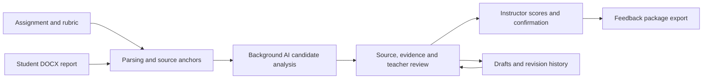

# Labwise · AI-Assisted Lab Report Review Workspace

[中文](README.md) | **English**

## Download the complete project

**[Download the complete project ZIP (latest main source)](https://github.com/CarryLewis/lab-report-assistant/archive/refs/heads/main.zip)**

Alternatively, select the green **Code → Download ZIP** button in this repository. Extract the archive into `lab-report-assistant-main`, then follow [Run locally](#run-locally) to install dependencies and start the application.

If Git is installed, clone the entire repository from a terminal:

```bash
git clone https://github.com/CarryLewis/lab-report-assistant.git
cd lab-report-assistant
```

This downloads the complete public project on the current `main` branch, including source code, documentation, tests, fictional examples and checked-in dependency assets. It is a source download, not a standalone installer; Python dependencies and Word conversion components still require setup. Local student material, databases and API keys are excluded.

## Project overview

Help university instructors understand English lab reports faster, trace feedback to source evidence, and retain control over every final judgment.

Labwise is a project for understanding, reviewing and providing feedback on university lab reports. It began with the needs of instructors in China who review English reports as non-native English speakers, focusing initially on report writing and rubric-based assessment in the British university context. Its longer-term aim is a workspace that fits everyday teaching practice.

Initiated by [CarryLewis](https://github.com/CarryLewis), the project is currently a local teacher pilot under active development. The active interface is **1.2.1**; interface versions, archived variants and future plans describe different implementation states.

## Why this project exists

Reviewing an English lab report combines language comprehension, reconstruction of the experimental argument, assignment checks, evidence search, citation and figure inspection, and feedback writing. These activities are often spread across Word, PDF readers, marking sheets, scholarly services and learning platforms.

Labwise organizes them into one reviewable workflow. It first helps instructors understand a report, connects potential strengths, problems and omissions to the current assignment, then supports instructor decisions on scores and feedback. Chinese explanations reduce reading effort while English passages and quotations preserve the basis for judgment.

The intended benefits are less time spent locating evidence and switching tools, fewer missed rubric requirements, and clearer assessment reasoning. These remain pilot evaluation goals. The project does not claim validated efficiency gains or automatic grading accuracy.

## Design philosophy

1. **Understand before assessing.** A section tree, overview and claim navigation help instructors follow the report. They are not scores.
2. **Start with the source.** Suggestions should refer to real paragraphs, exact quotations or figure objects. Evidence that cannot be located requires verification rather than a guessed anchor.
3. **Let the assignment and rubric define the review.** Instructors maintain requirements and point values. Each report retains its applicable rubric snapshot so later edits do not silently change its assessment basis.
4. **AI proposes; instructors decide.** Instructors accept, edit, reject or reopen suggestions and confirm scores and feedback. AI completion and instructor completion are separate states.
5. **Preserve uncertainty and provenance.** Source facts, model interpretations, rule checks and teacher decisions should remain distinguishable. A bibliographic match does not establish claim support; a chart image is not raw experimental data.
6. **Validate a small complete workflow before expanding.** Start with one instructor, one course and one report type. Use evidence errors, revision reasons and actual teaching experience to guide improvements.

## Instructor workflow

1. Create an assignment, enter its requirements, import or paste grading criteria, and verify criteria and scores.
2. Import individual or multiple DOCX reports into the assignment.
3. Let the backend parse and queue analysis; monitor waiting, analyzing, ready or failed states on the dashboard.
4. Open document navigation, source content and teacher review together. Follow each suggestion to its evidence.
5. Review candidate feedback, enter criterion scores, save a draft or confirm and continue to the next report.
6. Export instructor-confirmed feedback for existing teaching processes.



### Dashboard and core experience

The active interface has five entry points: **Dashboard, Courses and Assignments, Grading Standards, Data Analysis, and Settings and Audit**. The dashboard groups reports and grading progress by assignment. Current analytics primarily summarize saved processing states and are not evidence of educational effectiveness.

The core experience connects three areas:

- **Report navigation:** A tree based on actual headings, supported by summaries and existing claims.
- **Document reading:** Report text, tables and images, with access to specific supporting evidence.
- **Teacher review:** Rubric-aligned strengths and issues, editable feedback, criterion scores and confirmation.

A resizable workspace, continuous review checkpoints and saved revisions support instructors returning to the same assignment across sessions.

## Current implementation and limits

The repository contains a locally runnable teacher workflow: assignment and rubric maintenance, report import, SQLite drafts and revisions, background AI analysis, evidence-linked suggestions, instructor confirmation, Word review packages and structured score exports. Implementation is evolving. An endpoint or a successful focused check does not establish acceptance of every complex document, model request or batch scenario.

### Documents and source structure

The current submission workflow is **Word-first and accepts DOCX only** for new student reports. The parser reads body paragraphs, tables, common embedded images and available chart caches while retaining file digests, source paragraphs and object identifiers. The structure-recognition design favors explicit semantics, rules before AI, and traceable inference; full normalization is still being implemented in stages.

The Word reading view prioritizes anchored text, tables and common images. It is not Microsoft Word's layout engine. Complex equations, native charts, OLE objects and fonts may affect display or analysis coverage. Paginated rendering paths require local LibreOffice; historical PDFs use bundled PDF.js. Original files are retained, and instructors should check converted layouts.

### AI-assisted analysis

The backend assembles necessary content from the current assignment, rubric and report before calling the configured DeepSeek service. The Word analysis path can assemble text, tables and supported images. Resource exclusions, missing renderings and unsupported objects should appear as incomplete coverage.

Outputs pass field, rubric-dimension, paragraph and quotation checks before becoming suggestions. Network failures, missing credentials and invalid responses need recoverable states. Live analysis records exist for fictional examples; the latest Word multimodal path and representative complex submissions still require further acceptance testing.

### Citations, figures and scientific judgment

- **Citation verification:** In-text/reference checks and scholarly search across Crossref, PubMed and Europe PMC with identifier-based merging are included. The complete claim-to-citation-to-source-to-content-support chain remains a staged development goal.
- **Figures:** Local candidate discovery, page coverage, original-page inventories and teacher corrections are retained. The active Word workflow analyzes uploads automatically; earlier manual crop-and-send controls have left the main workflow. Full semantic classification, caption linking and batch scientific review require further implementation and validation.
- **Statistics:** Image observations and simple summaries cannot establish experimental replication, significance, causality or scientific correctness.

### Outputs and development status

Instructor-confirmed Word packages are designed to include originals, copies with native Word comments, feedback summaries and score data. Private review notes are excluded from student feedback. Comments currently anchor primarily to source paragraphs and retain actual supporting quotations.

**Subsequent local development:** Individual and merged review-PDF previews and exports have local implementation changes. They are separate from this documentation update and have not been published with it. Check the exact revision you have checked out.

The most recent pushed development checkpoint ran 42 Python tests: 34 passed and 8 errored. Legacy JavaScript workflow tests also had failures. Treat this as a development pilot that has not completed full regression acceptance. Check entry points appear below.

## System structure

The frontend uses HTML, CSS and vanilla JavaScript. Python serves local HTTP/API requests, SQLite stores assignments, reports, drafts, revisions and review state, and AI requests originate from the backend. Docker files support local packaging experiments. Institutional deployment still requires identity, access-control and operational work.

```text
lab-report-assistant/
├── index.html / teacher-*.js / teacher-*.css  Teacher entry and review interactions
├── assignment-editor.js / rubric_import.py   Assignment and rubric maintenance
├── server.py / pilot_backend.py             HTTP/API and application data
├── auto_analysis.py                         Analysis queue and recovery
├── word_source.py / word-reader.*            Word extraction and source anchors
├── document_preview.py / original-reader.*   Paginated preview and legacy PDFs
├── citation_core.py / citation-verification.js Citation checks and search interface
├── visual_discovery.py / visual_review.py    Figure discovery and review modules
├── review_progress.py / word_export.py       Continuous review and Word packages
├── vendor/pdfjs/                            Local PDF.js assets and licenses
├── docs/                                   Product design, implementation and charters
├── examples/ / tests/                       Fictional examples and regression tests
├── versions/ / archive/                     UI versions and old prototypes
└── .labwise/                                Local runtime data, excluded from Git
```

Conceptually, courses contain assignments with requirements and versioned rubrics. Each report retains its source and rubric snapshot; candidate analysis points to evidence; instructor decisions, revisions and exports build on those records. The personal local pilot does not implement a complete multi-tenant course-permission system.

## Data and responsibility

When automatic analysis is enabled and a service is configured, report content, images and grading criteria may be sent to an external AI provider. Institutional authorization, processing scope, retention and service conditions need confirmation before real use. Local storage does not mean all processing is offline. API keys are managed by the backend and should not enter Git or frontend code.

Historical student work, original teacher judgments and grades are intended for authorized local analysis or evaluation, not public demonstrations or silent reuse in another student's context. `corpus/historical/`, local databases, temporary files and rendered student documents are excluded from Git. Public examples use fictional material.

Instructors retain responsibility for scores and feedback. Turnitin, similarity and AI-detection results can only be separate reference sources, not automatic misconduct judgments. Institutional SSO, official grade writeback, live Turnitin synchronization and automatic student delivery are not implemented.

## Roadmap and quality goals

The immediate focus is a dependable individual-teacher workflow: parsing, evidence location, analysis recovery, item-by-item review, confirmation and export. Fixed fictional tests and authorized representative reports should strengthen regression coverage.

Citation, document-structure and figure charters guide later work on evidence chains, complex documents and scientific checks. Institutional identity, course permissions, LMS/Turnitin connections, multi-reviewer calibration and larger deployments are future work dependent on demonstrated needs, authorization and infrastructure.

Evaluation should cover evidence accuracy, unsupported suggestions, rubric alignment, reasons for major edits or rejections, comprehension and evidence-search time, and feedback usefulness. Acceptance rate is only a behavioral signal. Retrieval augmentation or specialized models should be evaluated after stable annotations and evaluation sets exist; the project has no completed trained automatic-grading model.

## Run locally

Install Python 3 and project dependencies. Paginated Word conversion additionally requires LibreOffice and suitable fonts. From the repository root:

```bash
python3 -m venv .venv
source .venv/bin/activate
python -m pip install -r requirements.txt
python server.py
```

Open <http://127.0.0.1:8000/>. On macOS, `start.command` is an alternative entry with default port 8001. `/pilot.html` is retained as a redirect.

Configure the AI service in Settings before live analysis. `LABWISE_PORT` controls the port, `LABWISE_DATA_DIR` the data directory, and `LABWISE_SOFFICE` the LibreOffice executable. `LABWISE_CONTACT_EMAIL` and optional `NCBI_API_KEY` identify scholarly requests. The prototype targets personal local use; deployment-level access control is required before public exposure.

```bash
python -m unittest discover -s tests -v
node tests/test_document_outline.js
node tests/test_ai_workflow.js
node tests/test_original_preview.js
```

These are check entry points, not a claim that every check passes. Historical validation records may describe different workflows and should be read alongside their corresponding revisions.

## Read more

- [Full project concept and AI constraints](PROJECT_BRIEF.md)
- [Product experience](docs/01_PRODUCT_AND_EXPERIENCE.md) · [Instructor workflow](docs/02_WORKFLOW_AND_OPERATIONS.md) · [Data and AI](docs/03_DATA_AND_AI_ANALYSIS.md) · [Pilot evaluation](docs/04_PILOT_AND_VALIDATION.md)
- [Platform integration](docs/05_PLATFORM_INTEGRATION.md) · [Identity and institutional access](docs/10_IDENTITY_AND_INSTITUTIONAL_ACCESS.md)
- [Citation charter](docs/CITATION_VERIFICATION_CHARTER.md) · [Structure charter](docs/DOCUMENT_STRUCTURE_RECOGNITION_CHARTER.md) · [Figure charter](docs/VISUAL_RECOGNITION_CHARTER.md)
- [Word-first review](docs/19_WORD_FIRST_REVIEW_WORKFLOW.md) · [Continuous review](docs/18_CONTINUOUS_REVIEW.md) · [Version records](versions/README.md)
- [Documentation index](docs/README.md) · [Development log](docs/DEVELOPMENT_LOG.md)

Discuss teaching needs, design ideas or reproducible issues through [GitHub Issues](https://github.com/CarryLewis/lab-report-assistant/issues). Use de-identified or fictional material to describe a case.
