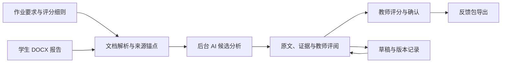

# Labwise · 实验报告智能辅助评阅工作台

**中文** | [English](README.en.md)

## 下载完整项目

**[下载完整项目 ZIP（main 最新源码）](https://github.com/CarryLewis/lab-report-assistant/archive/refs/heads/main.zip)**

也可以点击本仓库的绿色 **Code → Download ZIP**。下载后解压为 `lab-report-assistant-main` 文件夹，再按下方的[本地运行](#本地运行)说明安装依赖并启动。

如果已安装 Git，可在终端克隆整个仓库：

```bash
git clone https://github.com/CarryLewis/lab-report-assistant.git
cd lab-report-assistant
```

该入口下载当前 `main` 分支中的完整公开项目，包含源码、文档、测试、虚构示例和已纳入仓库的依赖资源。它是源码下载，不是免安装应用；Python 依赖和 Word 转换组件仍需按运行说明准备。本地学生资料、数据库及 API 密钥不包含在下载内容中。

## 项目简介

让高校教师更快读懂英文实验报告，让每条反馈都能回到原文证据，让最终判断始终由教师掌握。

Labwise 是一个面向高校教师的实验报告理解、评阅与反馈项目。它从中国高校非英语母语教师批改英文 Lab Report 的需求出发，关注英国大学体系下的报告写作与 Rubric（评分细则）对照，逐步探索可以融入日常教学的教师工作台。

本项目由 [CarryLewis](https://github.com/CarryLewis) 发起，目前处于本地教师试点与持续开发阶段。当前活动界面版本为 **1.2.1**；界面版本、历史快照与未来规划不代表相同的实现状态。

## 为什么做这个项目

批改英文实验报告需要同时完成语言理解、实验论证重建、课程要求对照、证据查找、引用与图表检查，以及反馈撰写。这些工作往往分散在 Word、PDF 阅读器、评分表、文献网站和教学平台之间。

Labwise 希望把这些步骤组织到同一个可审核界面中：先帮助教师理解报告，再把可能的优点、问题和缺失项与本次作业联系起来，最后由教师完成评分与反馈。中文解释用于降低理解成本，英文原文和短引文用于保留判断依据。

项目追求减少查找证据与切换页面的时间、减少 Rubric 对照中的遗漏，并让评阅理由更清楚。这些是需要通过试点评估的目标，目前没有经过验证的效率提升百分比或自动评分准确率承诺。

## 设计理念

1. **先理解，再评阅。** 章节树、概览和论点导航帮助教师掌握文章主线；它们本身不是分数。
2. **原文是判断的出发点。** 建议应关联真实段落、准确引文或图表对象。无法定位的证据应提示核实，不能猜测位置。
3. **作业与 Rubric 决定评阅范围。** 教师维护要求和分值。每份报告保留适用的标准快照，后续修改不应静默改变既有判断的依据。
4. **AI 提供候选意见，教师负责决定。** 教师可以采纳、编辑、拒绝或重新打开建议，并确认最终分数与反馈。AI 分析完成与教师批改完成是两个状态。
5. **保留不确定性与来源。** 原文事实、模型解释、规则检查和教师意见应可区分。文献元数据命中不等于引用支持论点，图表图像也不等于原始实验数据。
6. **先跑通小范围闭环，再扩大。** 从单个教师、一门课程、一类报告开始，用证据错误、教师修改原因和实际使用体验指导迭代。

## 教师如何使用

1. 创建作业题、填写要求，导入或粘贴自己的评分细则，并核对项目与分值。
2. 单份或批量导入学生 DOCX 报告，归入对应作业。
3. 后台解析并排队自动分析，在工作台查看等待、分析中、就绪或失败等状态。
4. 打开报告，同时查看文档导航、原文和教师评阅区，点击建议回到来源证据。
5. 逐条处理候选反馈，录入分项分数，保存草稿或确认后继续评阅下一份。
6. 导出教师确认的反馈包，供现有教学流程使用。



### 工作台与核心体验

活动界面包括五个入口：**工作台、课程与作业、评分标准、数据分析、设置与审计**。工作台按作业题组织报告和批改进度；数据分析目前以保存记录的状态统计为主，不能等同于教学效果研究。

核心评阅体验围绕三个相互联动的区域：

- **报告导航：** 根据实际章节形成树状目录，配合概览和已有论点定位内容。
- **文档阅读：** 查看报告正文、表格与图像，核对建议中的具体证据。
- **教师评阅：** 对照 Rubric 审核优点和问题，修改反馈、录入分数并确认结果。

可调整的工作区、持续评阅进度和保存后的版本记录，服务于教师多次返回同一作业的实际节奏。

## 当前实现与能力边界

仓库包含本地可运行的教师工作流：作业与标准维护、报告导入、SQLite 草稿和修订、后台 AI 分析、证据关联建议、教师确认，以及 Word 批改包和结构化成绩导出。功能仍在演进，接口存在或局部验证通过不代表复杂文档、模型请求和所有批量场景均已验收。

### 文档与来源结构

新学生报告采用 **DOCX 优先且仅接收 DOCX** 的流程。解析层读取 Word 正文、表格、常见内嵌图片和可用图表缓存，保留文件摘要、来源段落和对象标识。结构识别的总体设计遵循显式语义优先、规则先于 AI、推断可追溯，完整规范化能力仍按纲领逐步建设。

Word 阅读视图侧重可定位的文本、表格和常见图片，并非 Microsoft Word 的排版引擎。复杂公式、原生图表、OLE 对象和字体可能影响显示或分析覆盖。分页渲染路径依赖本机 LibreOffice；历史 PDF 记录使用内置 PDF.js 阅读器。原始文件保留，转换外观需要教师核对。

### AI 辅助分析

后端组织本次作业要求、Rubric 和当前报告的必要内容，再调用配置的 DeepSeek 服务。Word 分析路径可以组织正文、表格及受支持图像输入；超过资源限额、缺少渲染或不支持的对象应显示覆盖不足。

模型返回内容经过字段、Rubric 维度、段落和引文等验证，再作为候选意见进入界面。网络错误、缺少密钥或无效输出需要保留可恢复状态。仓库已有虚构样本的实时分析记录，最新 Word 多模态链路及代表性复杂作业仍需进一步验收。

### 引用、图表与科学判断

- **引用核验：** 已有正文引文/参考条目检查代码，以及 Crossref、PubMed、Europe PMC 多源检索与标识符合并。完整的“论点—引用—外部来源—内容支持”链路仍是分阶段建设目标。
- **图表能力：** 仓库保留本地图表候选发现、页面覆盖、原页目录和教师修订模块。活动 Word 流程已转向上传后自动分析，早期手动框选分析入口已退出主流程。完整语义分类、图注关联和批量科学审核仍需建设与验证。
- **统计边界：** 图像观察和简单数据汇总不能证明实验重复、显著性、因果关系或科学结论正确。

### 输出与开发状态

教师确认后的 Word 批改包设计包含原文件、带原生 Word 批注的副本、反馈摘要和成绩数据。私人评阅笔记不进入学生反馈；当前批注主要按来源段落锚定，反馈保留实际引文。

**本地后续开发：** 单份及合并评阅 PDF 的预览和导出已有本地改动，独立于此次介绍更新，尚未随其发布到远端。请以检出的具体提交为准。

最近已推送的开发快照执行了 42 项 Python 测试，34 项通过、8 项错误；旧 JavaScript 工作流测试也有失败。因此当前版本应视为开发试点，尚未完成全面回归验收。检查入口见下方。

## 系统结构

前端采用 HTML、CSS 和原生 JavaScript；Python 提供本地 HTTP/API 服务；SQLite 保存作业、报告、草稿、修订和评阅状态；AI 请求从后端发出。Docker 配置用于本地打包试验，学校部署还需要身份、权限和运维建设。

```text
lab-report-assistant/
├── index.html / teacher-*.js / teacher-*.css  教师入口与评阅交互
├── assignment-editor.js / rubric_import.py   作业与评分细则
├── server.py / pilot_backend.py             HTTP/API 与业务数据
├── auto_analysis.py                         后台分析队列与恢复
├── word_source.py / word-reader.*            Word 提取与来源定位
├── document_preview.py / original-reader.*   分页预览与历史 PDF
├── citation_core.py / citation-verification.js 引用检查与检索界面
├── visual_discovery.py / visual_review.py    图表发现与审核模块
├── review_progress.py / word_export.py       连续评阅与 Word 反馈包
├── vendor/pdfjs/                            本地 PDF.js 及许可证
├── docs/                                   产品设计、实施记录与纲领
├── examples/ / tests/                       虚构示例与回归测试
├── versions/ / archive/                     界面版本与历史原型
└── .labwise/                                本地运行数据，不纳入 Git
```

概念上，课程包含作业，作业有要求和版本化 Rubric；每份报告关联原文件及标准快照，候选分析关联来源证据，教师决定、修订和导出建立在这些记录之上。当前个人本地试点不代表完整多租户课程权限体系已经实现。

## 数据与责任

配置服务并开启自动分析后，报告内容、图像和评分细则可能发送给外部 AI 服务。实际使用前需要确认学校授权、处理范围、保存要求和服务条件。本地存储不等于全部处理离线。API 密钥由后端管理，不应提交到 Git 或放进前端源码。

历史学生报告、教师原评与评分资料用于经授权的本地分析或评测，不作为公开演示，也不应静默进入其他学生的分析上下文。`corpus/historical/`、本地数据库、临时文件和作业渲染件已排除在 Git 之外；公开示例使用虚构测试材料。

教师保留最终评分与反馈决定权。Turnitin、相似度或 AI 检测结果只能作为独立参考，不能自动判定学术不端。目前未实现学校单点登录、正式成绩回写、实时 Turnitin 同步或学生端自动投递。

## 路线与质量目标

近期重点是稳定个人教师闭环：解析、证据定位、分析失败恢复、逐条审核、确认和导出，并用固定虚构测试与经授权的代表性报告完善回归。

后续按引用、结构和图表纲领增强证据链、复杂文档覆盖与科学检查。学校身份、课程权限、LMS/Turnitin 对接、多人校准和扩大部署属于后续规划，需要真实需求、授权与基础设施支持。

评价重点包括证据准确性、无依据建议比例、Rubric 匹配、教师重大修改和拒绝原因、理解/定位所需时间，以及反馈可用性。采纳率只是行为信号。建立稳定标注和评测集后，再评估检索增强或专门模型；目前没有训练完成的自动评分模型。

## 本地运行

需要 Python 3 和项目依赖；Word 分页转换另需 LibreOffice 及适当字体。从仓库根目录执行：

```bash
python3 -m venv .venv
source .venv/bin/activate
python -m pip install -r requirements.txt
python server.py
```

打开 <http://127.0.0.1:8000/>。macOS 也可使用 `start.command`，默认端口为 8001。`/pilot.html` 是保留的重定向入口。

在设置中配置 AI 服务后再运行实际分析。`LABWISE_PORT` 控制端口，`LABWISE_DATA_DIR` 控制数据目录，`LABWISE_SOFFICE` 指定 LibreOffice。`LABWISE_CONTACT_EMAIL` 与可选的 `NCBI_API_KEY` 用于文献请求。原型以本机个人使用为目标，公开访问前需要部署级访问控制。

```bash
python -m unittest discover -s tests -v
node tests/test_document_outline.js
node tests/test_ai_workflow.js
node tests/test_original_preview.js
```

以上是检查入口，不表示当前全部通过。历史验证与新版实施说明可能采用不同流程，应结合对应提交阅读。

## 深入阅读

- [完整项目构想与 AI 约束](PROJECT_BRIEF.md)
- [产品体验](docs/01_PRODUCT_AND_EXPERIENCE.md) · [教师工作流](docs/02_WORKFLOW_AND_OPERATIONS.md) · [数据与 AI](docs/03_DATA_AND_AI_ANALYSIS.md) · [试点评估](docs/04_PILOT_AND_VALIDATION.md)
- [平台接入](docs/05_PLATFORM_INTEGRATION.md) · [身份与学校访问](docs/10_IDENTITY_AND_INSTITUTIONAL_ACCESS.md)
- [引用核验纲领](docs/CITATION_VERIFICATION_CHARTER.md) · [结构识别纲领](docs/DOCUMENT_STRUCTURE_RECOGNITION_CHARTER.md) · [图表识别纲领](docs/VISUAL_RECOGNITION_CHARTER.md)
- [Word 优先工作流](docs/19_WORD_FIRST_REVIEW_WORKFLOW.md) · [连续评阅](docs/18_CONTINUOUS_REVIEW.md) · [版本记录](versions/README.md)
- [文档索引](docs/README.md) · [开发记录](docs/DEVELOPMENT_LOG.md)

欢迎通过 [GitHub Issues](https://github.com/CarryLewis/lab-report-assistant/issues) 讨论教学场景、产品设计或可复现问题；请使用去标识化或虚构材料描述案例。
