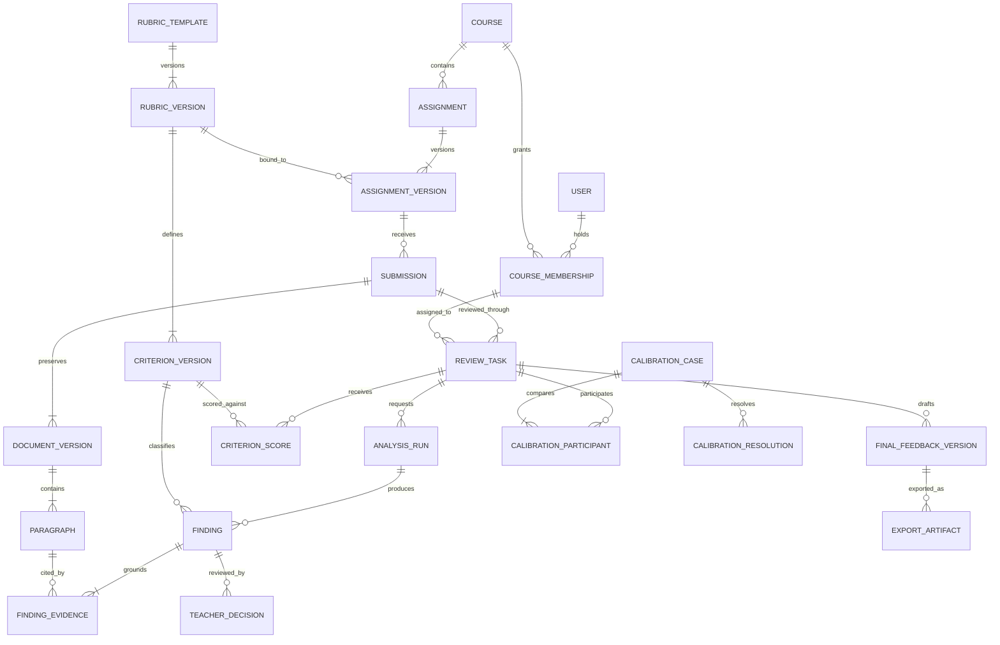

# Teacher Navigation and Domain Model

The original teacher pilot remains the single product shell. The six numbered
navigation items organize the instructor workflow. The three-column review
workspace remains the destination opened from a review task, rather than a
separate product or a seventh top-level module.

## 01 — Dashboard / 工作台

**Teacher question:** What needs my attention now?

The page contains course context, task counts, review progress, prioritized review
tasks and the report import entry. A task opens the existing source/map/feedback
workspace. Useful filters for the next integrated iteration are assignment,
review stage, due date and assigned reviewer. Counts must derive from task states;
they must not count individual AI suggestions as reports.

**Entities:** CourseMembership, ReviewTask, Submission, AssignmentVersion,
FinalFeedbackVersion. Dashboard metrics are projections of those records.

**Task states:** pending → in_review → reviewed → confirmed → exported.
A failed analysis belongs to AnalysisRun and can be retried without deleting the
submission. Restoring or editing confirmed feedback creates a draft and requires
fresh confirmation. Export is not evidence that a student has received feedback.

**Current implementation:** the dashboard and review workspace retain their labeled
interactive example tasks. The dashboard counts are demonstration values, not
live course statistics. They are excluded from module 05.

## 02 — Courses and Assignments / 课程与作业

**Teacher question:** What is this assignment, and what must students do?

The page starts with course context. The main editor contains an assignment name,
assignment requirements, and one grading-criteria input that accepts Word (.docx),
text-based PDF or pasted text. The right side lists saved assignments and presents
a readable preview. Selecting an assignment allows editing; new assignments have
a separate new action. No JSON, database fields or API terms appear in this form.

**Entities:** Course, Assignment, AssignmentVersion, RubricVersion, ImportSource.
Each assignment belongs to a course. An assignment version pins instructions and
one grading-standard version. The import source preserves the teacher's original
text separately from the extracted criteria.

**Rules:** show extracted criteria and explicit maxima for teacher review; never
invent absent weights or silently reconcile conflicting totals. Updates create
versions. Existing report snapshots retain the instructions and criteria that
were originally used.

**Current implementation:** a fixed pilot course, SQLite-backed assignment creation
and editing, local Word/PDF extraction, pasted text, readable previews and stored
assignment revisions. Complex tables and implicit grading schemes may need the
teacher to clarify their wording. PDF scans require prior text recognition.

## 03 — Grading Standards / 评分标准

**Teacher question:** Which criteria should I apply, and can I reuse them?

The page has a selectable standards library and a criterion detail panel. Each
entry shows its source assignment or reference-template status, criterion names,
maxima and descriptions. Actions are to edit the source assignment, reuse a
standard in a new assignment, or start a new standard through the assignment form.

**Entities:** RubricTemplate, RubricVersion, CriterionVersion,
AssignmentVersion's rubric binding. Instructor feedback examples can later be
associated with a criterion version and authorized course scope.

**Rules:** reference templates are not institutional policies. A reused standard
creates a separate assignment rather than changing the source. Default guidance
must not silently change a teacher-provided rubric or combine independent scores.
A score always points to the exact criterion version used in that review.

**Current implementation:** views over saved assignment rubrics plus a clearly
labeled reference template; copy/edit actions reuse module 02. Rubric templates
are not yet an independently persisted multi-course library.

## 04 — Team and Calibration / 团队与校准

**Teacher question:** Why do reviewers disagree, and what interpretation do we use?

The page shows course reviewers, calibration cases, paired judgments, shared
source evidence and a decision/notes area. A case opens the existing report
workspace to inspect evidence. The interface distinguishes an initial opinion,
a second opinion and an adjudicated result; it never averages them automatically.

**Entities:** CourseMembership, ReviewAssignment, CalibrationCase,
CriterionRating, CalibrationResolution. A case joins reviews of the same document
and criterion version. Cross-version comparisons require an explicit mapping.

**Rules:** only authorized reviewers may see peer feedback. A reviewer cannot
silently overwrite another reviewer’s judgment. A resolution needs an authorized
teacher, a rationale, a timestamp and a link to both original judgments. Human
assignment and notification require explicit teacher actions.

**Current implementation:** clearly labeled fictional calibration examples and
browser-local decision notes. No invitations, real peer accounts, permissions,
message delivery or shared adjudication service are implemented.

## 05 — Review Analytics / 数据分析

**Teacher question:** How is marking progressing, and what requires follow-up?

The initial page supports assignment selection, imported-report totals, current
processing states and recent saved reports. Empty real datasets show an honest
empty state. Future views may include teacher-confirmed score distributions,
criterion-level issue frequency, correction reasons and turnaround time.

**Entities:** read-only projections from ReviewTask, AnalysisRun,
CriterionScore, TeacherDecision and FinalFeedbackVersion. Analytics do not become
a separate source of grading truth.

**Rules:** filter by stable course/assignment IDs; exclude fictional samples by
default; distinguish analysis completion from teacher confirmation. Scores from
different scales, criterion sets or rubric versions are not averaged together.
Time saved requires an actual baseline, not an assumed AI benefit. AI confidence
is not an independently validated probability or a grading threshold.

**Current implementation:** real local report counts by processing state, filtered
by assignment ID, with sample reports excluded. The page does not invent score
distributions or populate charts from dashboard demonstration values.

## 06 — Settings and Activity / 设置与审计

**Teacher question:** How do I adjust my workspace and trace changes?

The page contains teacher display name, source reading size/spacing and recent
actions on this browser. The settings do not alter student text or grades. Future
institutional controls should be separated into authorized administration areas
for course membership, retention, external-service consent and audit access.

**Entities:** UserPreference, CoursePolicy, ServiceConfiguration, AuditEvent.
A secret belongs to server-side configuration and must not be returned in page
payloads. API and storage details do not belong in ordinary teacher workflow.

**Rules:** instructor-private notes and student-visible feedback remain separate.
A formal audit event records actor, action, object, version and time. It does not
contain API keys or full report text. Shared audit logs require server-side access
control and append-only behavior.

**Current implementation:** browser-local reading preferences and a capped activity
list for assignment saves, calibration notes and preference changes. This list is
not a tamper-resistant institutional audit log. Multi-user authorization is not
implemented by visual role labels.

## Domain Relationships

## Entity Fields and Invariants

- **User:** user_id, display_name. Membership supplies course-specific permissions;
  a visual profile label is never an authorization check.
- **Course:** course_id, code, name, term, status. All assignment/report access must
  resolve back to the current course and membership.
- **CourseMembership:** membership_id, course_id, user_id, role, status. Proposed
  roles are owner, reviewer and moderator, with least-privilege actions.
- **Assignment:** assignment_id, course_id, title, active_version_id, status.
  AssignmentVersion stores immutable instructions, rubric_version_id, version,
  author and time. New submissions select an active version explicitly.
- **RubricTemplate / RubricVersion:** stable template identity, course scope,
  version, source, scoring scale and approval state. CriterionVersion stores a
  stable criterion key within a rubric version, name, maximum and descriptors.
- **ImportSource:** import_id, owner/course scope, source filename, extracted text,
  parse status and confirmed version. Preserve source text for correction; do not
  mistake successful extraction for teacher confirmation.
- **Submission / DocumentVersion:** submission_id, assignment_version_id,
  student_alias; document_version_id, file metadata, content hash, parse status.
  Paragraph identity is the pair (document_version_id, paragraph_key).
- **ReviewTask:** task_id, submission_id, reviewer membership, pinned
  document/rubric versions, due date, stage, optimistic revision. A newly uploaded
  document does not silently change an existing review task’s evidence.
- **AnalysisRun:** run_id, task_id, source versions, model identifier, prompt and
  schema versions, state, timestamps and recoverable error. Reanalysis is a new run.
- **Finding / FindingEvidence:** finding_id, run_id, criterion_version_id, kind,
  rationale, candidate feedback; source document/paragraph, exact quotation.
  Evidence must belong to the pinned document and locate in its text.
- **TeacherDecision:** decision_id, finding_id, task_id, actor, accept/edit/reject
  state, edited feedback and time. It must remain separate from the AI output.
- **CriterionScore:** task_id, criterion_version_id, score, actor and confirmation.
  Enforce bounds and uniqueness per task/criterion; do not add scores from findings.
- **FinalFeedbackVersion / ExportArtifact:** final text, teacher confirmation,
  associated decisions and scores; output format, source feedback version and time.
  Exports exclude private notes; editing/restoring requires fresh confirmation.
- **CalibrationCase / Participant / Resolution:** criterion/document version,
  compared task IDs, decision authority, final interpretation and rationale.
  Preserve each original reviewer judgment alongside the resolution.
- **UserPreference / AuditEvent:** user scope and reading options; actor, action,
  object identity/version and timestamp. Audit visibility follows course scope.

## Current Storage and Migration

The existing pilot intentionally uses a smaller physical schema:

- assignments: current title, requirements, embedded rubric and revision.
- assignment_versions: previous assignment snapshots retained on edit.
- reports: parsed paragraphs, pinned assignment/rubric snapshot, analysis and
  instructor state in one payload.
- revisions: report state before changes or restoration.
- settings: non-secret service configuration.
- Browser-local state: reading preferences, demonstration calibration notes and
  device activity records.

The entity diagram above is the target domain design, not a claim that all those
normalized tables or multi-user permissions already exist. First migrate course,
assignment versions and rubric versions; then task/document/evidence identity;
then add shared calibration and controlled audit services. Preserve all original
snapshots, aliases and paragraph references during migration. Do not relabel
sample records as real submissions or promote local notes to shared decisions.

## Acceptance Checks

1. Each numbered navigation entry opens its own page and highlights itself.
2. Module 02 edits requirements; module 03 edits/reuses evaluation standards via
   the same canonical saved assignment rather than creating conflicting copies.
3. Selecting a dashboard task still opens the original three-column workspace.
4. Samples are visible as samples and excluded from real analytics.
5. Changes to an assignment never rewrite existing report rubric snapshots.
6. Calibration exercises cannot imply that real colleagues have reviewed a report.
7. Reading preferences alter display only; activity history exposes no secrets.
8. Mobile navigation exposes all six destinations and can be dismissed by Escape.
