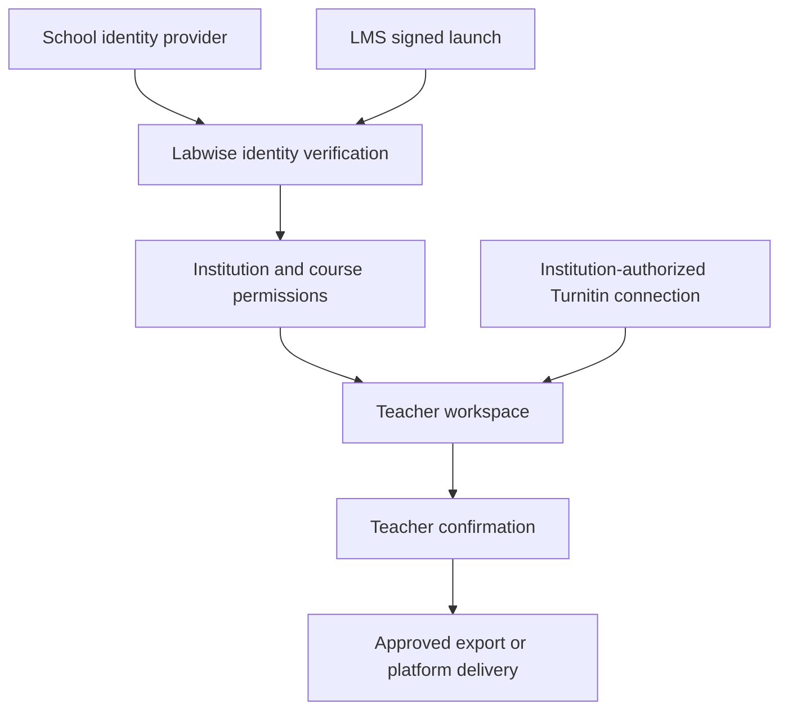

# Identity and Institutional Access Plan

Status: proposed design; reviewed 23 October 2026. This document supplements
[platform integration](05_PLATFORM_INTEGRATION.md) and the
[navigation and domain model](09_NAVIGATION_AND_DOMAIN_MODEL.md).
It does not introduce working authentication into the current interactive pilot.

## 1. Product decision

Use school identity as the primary sign-in method, course membership to authorize
work, and separately approved integrations to access Turnitin or an LMS.
A successful login alone never grants access to reports or permission to publish
grades. The initial institutional release is for teachers; student access is a
later, separately scoped view of their own released feedback.

The user clarified that the proposed external account was Turnitin, not Tencent.
Turnitin's public SSO documentation describes institution-configured sign-in to
Turnitin. Its Core API documentation describes tenant API keys. Neither establishes
a general-purpose “Sign in with Turnitin” facility for arbitrary third-party apps.
Keep that option conditional on written confirmation of a supported vendor flow.
Do not collect Turnitin passwords or automate its login pages.

Two applications may use the same school identity while maintaining independent
sessions, permissions and service contracts. A school login to Labwise does not
transfer a teacher's Turnitin session or license.

## 2. Teacher experience

Standalone entry: choose school → select “学校统一登录” → authenticate on the
school's own page → return to “我的课程”. Student/staff numbers are entered on the
school identity page; Labwise does not store school passwords.

From an LMS: open the course tool → validate the signed platform launch → resolve
the institution, course and permitted role → open the corresponding course.
Missing or conflicting course mappings stop access and offer administrator help.

First sign-in without an assigned course shows “身份已验证，等待课程授权”.
“试用示例” remains visibly separate and contains only fictional records. A verified
school email is not sufficient evidence of teacher status or course access.

Module 01 displays authorized tasks; modules 02–05 operate within the selected
course. Module 04 reviewer assignments must resolve to actual course memberships.
Module 06 offers personal account information and linked sign-in methods.
Institution connection setup belongs to an administrator-only area, with readable
labels such as “学校登录”, “教学平台” and “Turnitin 连接”. Teachers do not see client
secrets, token payloads or raw protocol settings.

## 3. Integration structure

Prefer OpenID Connect Authorization Code flow with PKCE where the school supports
it. Support SAML 2.0 through a maintained identity adapter or broker when required.
If a school requires CAS or another protocol, assess its supported bridge before
committing to an implementation. Do not implement every protocol in the pilot.
Use stable adapters so provider differences do not enter grading logic.

For LMS entry, plan LTI 1.3. Register each platform deployment and map its verified
issuer, client ID, deployment ID and context ID to an institution and course.
Only accepted, signed launch claims may establish this context. Roster retrieval
and grade return need their own service authorization; a launch does not grant
all LMS capabilities. Instructor confirmation remains required before delivery.

Turnitin is a separate institution-owned installation. Confirm the licensed
product, tenant, available APIs, data handling agreement and supported operations.
Core API submission/report access does not imply permission to write Feedback
Studio comments, QuickMarks or grades. Store credentials on the server and expose
only connection status to ordinary users. Preserve external report provenance;
external similarity results do not become automatic misconduct findings.

## 4. Identity and permission entities

- Institution: tenant boundary, name and institution policy.
- User: stable internal ID and minimal profile; no school password.
- IdentityProviderConnection: institution, protocol, trusted issuer, approved
  configuration and server-side secret references.
- ExternalIdentity: provider connection plus immutable external subject mapped
  to a user. Use a uniqueness constraint on that pair. Email, name and staff/student
  number are mutable attributes rather than account keys.
- InstitutionMembership: institution, user, status and administrative role.
- CourseMembership: institution, course, user, scoped role and lifecycle status.
- PlatformDeployment: trusted LMS registration and deployment-to-institution map.
- IntegrationInstallation: institution-authorized service, credential reference,
  granted capabilities, status and responsible administrator.
- ExternalResourceMapping: scoped external course, assignment and submission IDs
  mapped to internal records; never match on display names alone.
- Session and AuditEvent: session expiry/revocation and attributable access,
  connection, membership, confirmation and delivery events.

Enforce institution and course scope on every server operation, including files,
search, analysis, exports and background jobs. Never trust a tenant ID or role
submitted by the browser. Institution administrators manage connections; teachers
manage assigned coursework; assistants receive explicit course permissions;
students can only see their own released material when that feature is enabled.

A person can belong to multiple schools without sharing their course data.
Do not merge accounts based on matching email or name. Linking an additional
identity requires fresh proof of both accounts and institution policy checks.
Disconnecting a login method preserves report authorship and audit history.
Changes to a staff number must not change attribution of existing feedback.

## 5. Session and lifecycle rules

Use maintained authentication libraries. Validate issuer, audience, signatures,
expiry and request binding; apply state/nonce/PKCE and replay protections as
appropriate to the protocol. Restrict callbacks and provider configuration to
administrator-approved values. Use server-managed sessions with Secure, HttpOnly
cookies, appropriate SameSite configuration and CSRF protection. Do not place
service keys or long-lived authentication tokens in browser storage.

School MFA requirements remain effective. Define idle and absolute session limits,
logout behavior, membership refresh and revocation with each institution. Do not
promise that logging out of Labwise logs out of every connected system. Suspended
memberships must lose access through existing sessions and background actions
within a documented revocation window. Sensitive actions may require renewed
verification under institution policy.

Use institution claims or an approved roster source for roles and course lists.
Conflicting mappings require administrator resolution. AI must never determine
identity, grant roles, select tenant scope or authorize a grade release.
Collect only identity attributes needed for teaching and attribution; document
retention, account closure and institutional export responsibilities.

## 6. Delivery stages

1. Current prototype: preserve the existing teacher workflow and example entry.
   Document account states and adapter contracts. Do not treat local preferences
   or the local database as a shared, authenticated campus service.
2. One-school sandbox: connect one real test identity provider, enforce server
   sessions and course permissions, and provide administrator-controlled
   membership. Use synthetic second-institution records to check isolation.
3. LMS access: register an LTI 1.3 deployment, map courses and roles, then add
   separately authorized roster or grade services where needed.
4. Turnitin integration: proceed after institutional and vendor approval; expose
   only supported licensed operations. Consider direct Turnitin account sign-in
   only if a documented third-party identity flow is confirmed.
5. Wider release: add additional institutions, lifecycle automation and a scoped
   student experience after the teacher pilot meets its acceptance criteria.

## 7. Information required from the institution

Obtain a technical contact, supported identity protocol, test registration,
HTTPS deployment domain and callbacks, immutable identity identifier, available
membership/role claims, roster source, MFA/session policies and revocation process.
For LMS access obtain platform registration and deployment administration support.
For Turnitin obtain the exact product, institutional license, approved API scope,
tenant details and vendor confirmation. Teachers should not need to supply their
personal service passwords to arrange any of these connections.

## 8. Acceptance criteria for a future implementation

- Valid school sign-in resolves to the correct internal user and authorized courses.
- Tampered, expired, replayed or wrong-audience messages are rejected.
- Cross-institution file URLs, API requests, analysis jobs and exports are denied.
- A student or assistant cannot acquire teacher privileges by editing a request.
- Matching names/emails do not silently merge accounts; staff-number changes
  preserve prior authorship.
- Suspension removes access within the agreed revocation window.
- An LMS launch cannot select an unregistered deployment or unrelated course.
- Account linking and disconnection preserve attributable grading history.
- Example entry cannot reach real institutional records.
- Connection failure gives a readable recovery path and never bypasses permission
  checks; Turnitin outages do not erase teacher work.
- Final feedback delivery requires the appropriate permission and teacher approval.

These are future acceptance requirements, not claims that checks have run against
the current prototype.

## Official references

- [OpenID Connect Core](https://openid.net/specs/openid-connect-core-1_0.html): identity protocol and verified subject claims.
- [OASIS SAML technical overview](https://docs.oasis-open.org/security/saml/Post2.0/sstc-saml-tech-overview-2.0.html): federation concepts.
- [1EdTech LTI 1.3](https://www.imsglobal.org/spec/lti/v1p3): signed platform launches, deployment, context and roles.
- [Turnitin SSO hub](https://guides.turnitin.com/hc/en-us/articles/27917555813005-Single-Sign-On-hub): institution/product-dependent setup.
- [Turnitin Feedback Studio SSO setup](https://guides.turnitin.com/hc/en-us/articles/21698284504205-Setting-up-SSO-for-Feedback-Studio-and-Originality-Check): institutional sign-in options.
- [Turnitin Core API migration guide](https://developers.turnitin.com/turnitin-core-api/migrating-from-ithenticate-api): API-key authentication and submission/report workflow.

Vendor capabilities must be reconfirmed when an institution begins implementation.
